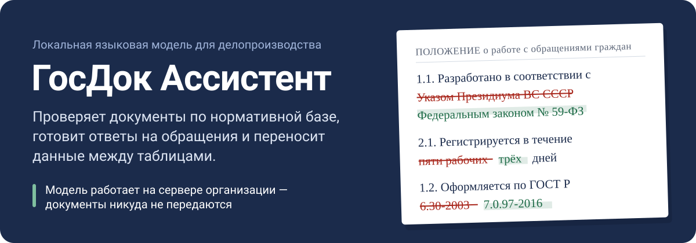
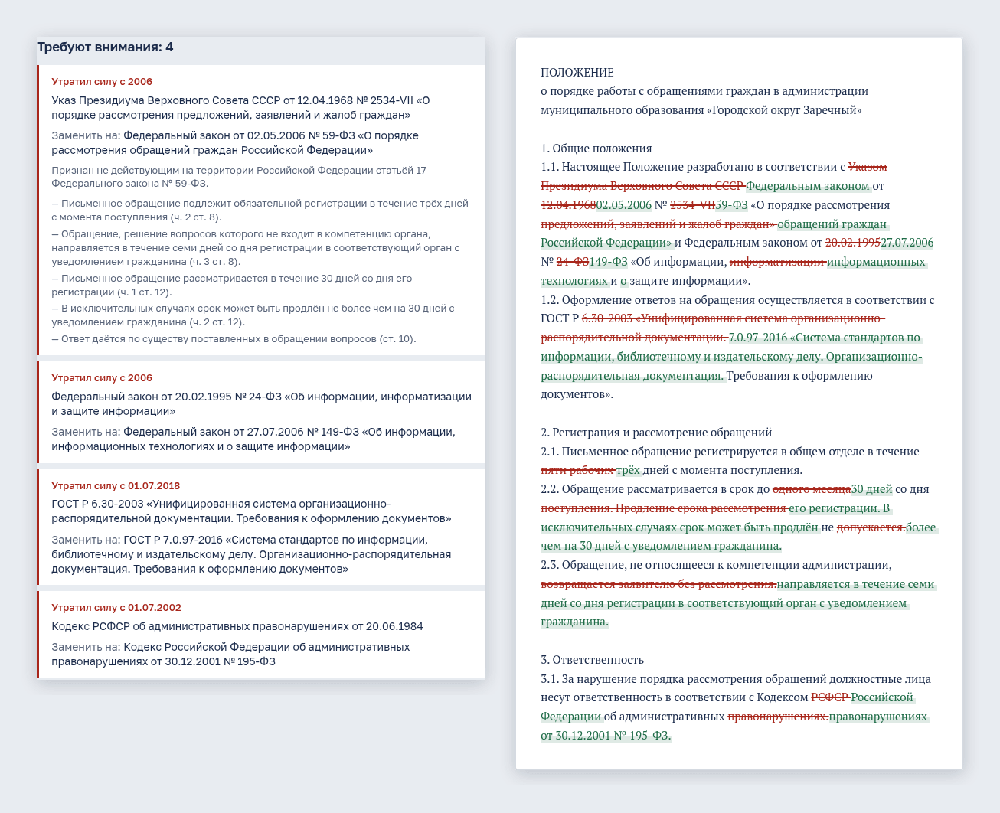
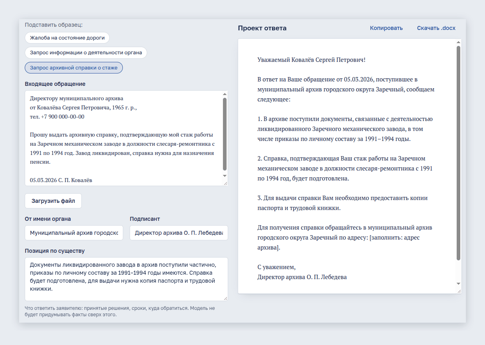
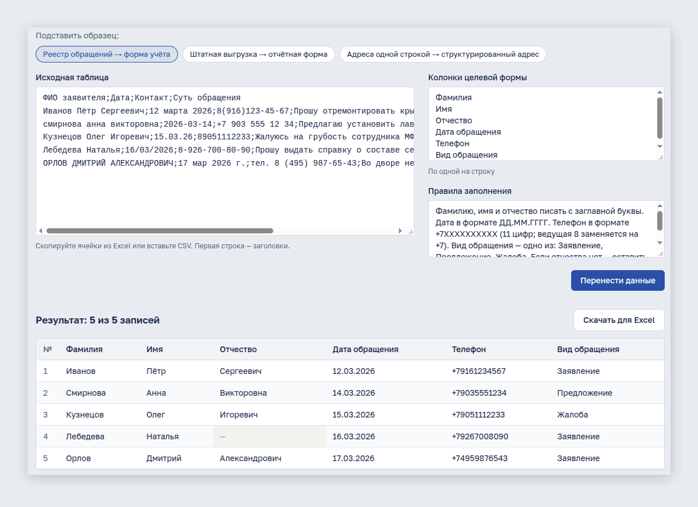
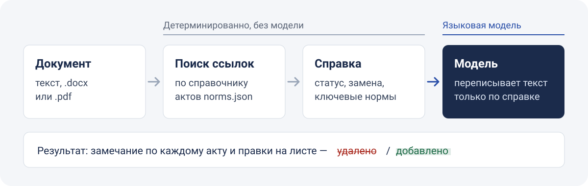
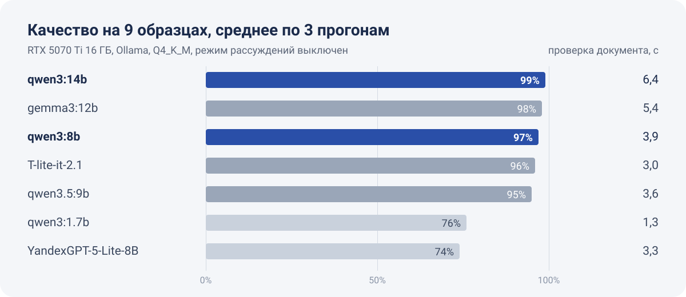

<p align="center">
  
</p>

<p align="center">
  <a href="https://github.com/Fgeeha/light-gosdoc-assistant/actions/workflows/ci.yml"></a>
</p>

Прототип для демонстрации того, что может локальная языковая модель в органах власти и
подведомственных учреждениях. Модель запускается на сервере организации: тексты документов и
персональные данные не уходят во внешние сервисы.

<p align="center">
  
</p>

<p align="center"><sub>Реальный результат на образце «Положение о работе с обращениями граждан», модель qwen3:14b.</sub></p>

## Что умеет

### Проверка по нормативной базе

Пользователь вставляет положение, регламент или ТЗ (или загружает .docx / .pdf) и нажимает
«Проверить». Система находит ссылки на отменённые и изменённые акты, объясняет, чем они заменены,
и предлагает актуальную редакцию. Правки подсвечиваются на экране: удалённое зачёркнуто,
добавленное выделено. В .docx выгружается чистовик без пометок.

### Ответ на обращение

По входящему обращению и позиции исполнителя готовит проект ответа по 59-ФЗ / 8-ФЗ — по существу
каждого вопроса. Сведения, которых нет в позиции, помечаются `[заполнить: …]`. Выгрузка в .docx.

<p align="center">
  
</p>

### Перенос таблиц

Переносит записи из выгрузки (Excel, CSV) в целевую форму: разбирает ФИО и адреса, приводит даты
и телефоны к единому формату, классифицирует и считает. Результат скачивается в CSV для Excel.

<p align="center">
  
</p>

Для каждого сценария есть образцы — кнопки «Подставить образец» на странице.

## Как устроена проверка

<p align="center">
  
</p>

Ссылки на акты находятся детерминированно, по справочнику `backend/app/data/norms.json`
(статус, дата утраты силы, замена, ключевые нормы). Модель получает готовую справку и только
переписывает текст по ней — поэтому она не может «придумать» статус закона. В демо-справочнике
19 актов; ссылки на акты вне справочника помечаются «нет в базе, проверьте вручную».
В эксплуатации справочник подключается к официальному источнику (pravo.gov.ru, СПС).
Как добавить акт или отметить, что закон утратил силу, — в [docs/NORMS.md](docs/NORMS.md).

## Быстрый старт

Нужны Docker с Compose и сервер модели с OpenAI-совместимым API.

```bash
cp .env.example .env        # заполнить SECRET_KEY, ADMIN_PASSWORD, POSTGRES_PASSWORD
ollama pull qwen3:14b       # если модель на хосте; запускать с OLLAMA_CONTEXT_LENGTH=16384
make up-local               # собрать образы и запустить
```

Сайт — http://localhost:8080, вход — `ADMIN_USERNAME` / `ADMIN_PASSWORD` из `.env`. Учётные
записи сотрудников заводит администратор в разделе «Пользователи».

<details>
<summary>Модель в контейнере на GPU</summary>

Нужен NVIDIA Container Toolkit. В `.env` задать `COMPOSE_PROFILES=ollama` и
`LLM_BASE_URL=http://ollama:11434/v1`, затем:

```bash
docker compose --env-file .env -f docker/docker-compose.yml exec ollama ollama pull qwen3:14b
```

</details>

<details>
<summary>Готовые образы для сервера</summary>

CI собирает образы при каждом push в `main` и при тегах `v*`:

- `ghcr.io/fgeeha/light-gosdoc-assistant-backend`
- `ghcr.io/fgeeha/light-gosdoc-assistant-frontend`

На сервере достаточно `docker/docker-compose.yml`, `.env` и `make up-prod`.

</details>

## Какую модель брать

<p align="center">
  
</p>

**Семейство Qwen3:** `qwen3:14b` для GPU 12–16 ГБ, `qwen3:8b` для GPU 8 ГБ. Режим рассуждений
выключен: он добавляет 1 п. п. качества, но замедляет ответ в 2,5–3,5 раза. T-lite-it-2.1 быстрее,
но в 4 из 6 писем выдумывала телефон. Методика, характерные ошибки каждой модели и исходные
отчёты — в [docs/MODELS.md](docs/MODELS.md).

Подключение другого сервера модели:

| Сервер | `LLM_BASE_URL` | `LLM_EXTRA_BODY` |
|---|---|---|
| Ollama | `http://host:11434/v1` | `'{"reasoning_effort":"none"}'` для Qwen3 |
| vLLM | `http://host:8000/v1` | `'{"chat_template_kwargs":{"enable_thinking":false}}'` для Qwen3 |
| llama.cpp server | `http://host:8080/v1` | — |
| Облачный провайдер | URL провайдера, ключ в `LLM_API_KEY` | — |

## Архитектура

```
браузер ──► frontend (nginx + React) ──/api──► backend (FastAPI) ──► PostgreSQL
                                                    │
                                                    └──► LLM: любой OpenAI-совместимый API
                                                         (Ollama, vLLM, llama.cpp, облако)
```

- Ответы модели передаются потоком (SSE) — текст появляется по мере генерации.
- Доступ только авторизованным пользователям. Сессия — подписанный JWT в httpOnly-cookie,
  выход и смена пароля отзывают все сессии. Вход ограничен по частоте в nginx.

## Образцы

Исходные документы лежат в `backend/app/data/examples/docs/`: .docx для документов и обращений,
.csv/.tsv для таблиц. Их текст разбирается в `examples/*.json` командой `make examples`, а тест
следит, чтобы JSON не расходился с исходниками. Для документов на проверку рядом лежит эталонная
редакция (`*.expected.docx`) — на странице она открывается вкладкой «Эталон юриста» для сравнения
с правками модели. Исходный .docx образца можно скачать, чтобы показать загрузку файла.

## Разработка

```bash
make install        # uv sync + npm ci
make run            # бэкенд на :8000 (SQLite)
make run-frontend   # фронтенд на :5173 с прокси /api
make check          # ruff, tsc, pytest
make bench MODELS="qwen3:14b gemma3:12b"   # сравнить модели на образцах
make examples       # пересобрать тексты образцов из docs/
```

## Ограничения

- Это демонстрационный прототип. Справочник актов небольшой (19 записей), 9 образцов — не
  статистически значимый тест моделей.
- Модель может добавить в письмо факты, которых нет в позиции исполнителя (например, конкретные
  сроки работ). Проект ответа вычитывается перед отправкой.
- Перенос таблиц — до 500 строк за раз; загружаемые файлы — до 10 МБ.
- Миграций БД нет: схема создаётся при старте, изменение схемы потребует миграции.
